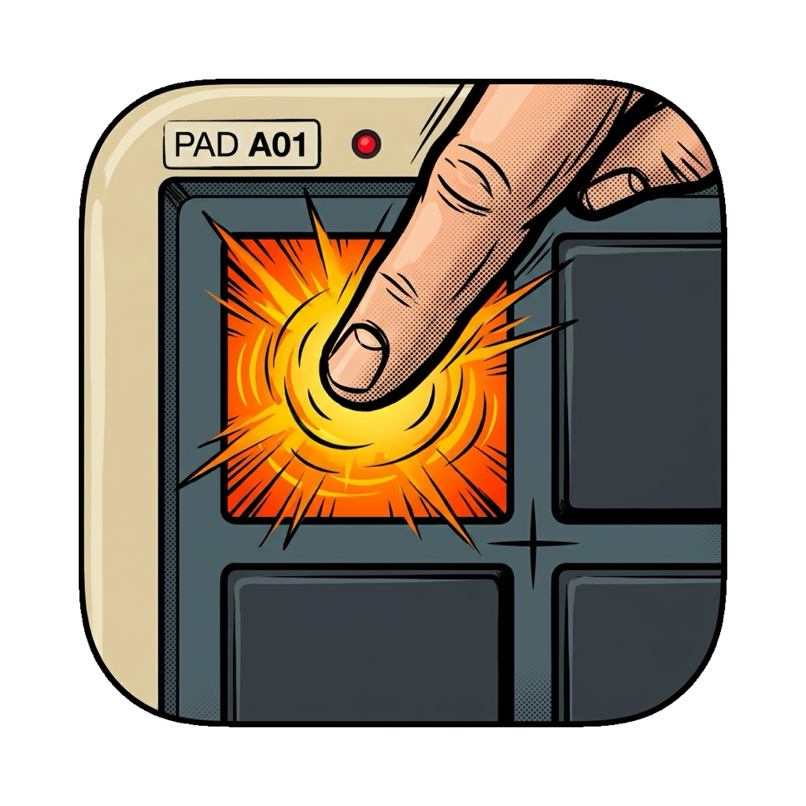
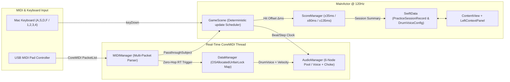

<div align="center">



# FingerIN (`PAD A01`)

**A Retro-MPC Inspired Educational Finger-Drumming Rhythm Game for macOS**  
*Built natively with SwiftUI, SpriteKit (120Hz), CoreMIDI, AVAudioEngine, and SwiftData.*

[](https://totallyraiva.github.io/FingerIN/)
[-FFB800?style=for-the-badge&logo=apple&logoColor=black)](https://totallyraiva.github.io/FingerIN/downloads/FingerIN.dmg)

-111216?style=flat-square&logo=apple)


</div>

---

## 🌐 Live Interactive Showcase & `.DMG` Download

- **Interactive GitHub Page (CV / Portfolio Showcase):** [**https://totallyraiva.github.io/FingerIN/**](https://totallyraiva.github.io/FingerIN/)  
  *Includes an interactive browser-based Retro MPC pad deck powered by the actual app `.wav` samples, live 16-step groove sequencer, Rhodes/Bass synth accompaniment, and an 18-groove visual matrix explorer.*
- **Direct macOS Installer Download (`.dmg`):** [**Download `FingerIN.dmg` (v1.0.0 · 2.8 MB)**](https://totallyraiva.github.io/FingerIN/downloads/FingerIN.dmg) *(or via [GitHub Raw](https://github.com/TotallyRaiva/FingerIN/raw/main/docs/downloads/FingerIN.dmg))*
  - **SHA-256:** `9bb8d360256fb138ac1f6687b3d1933485249db125b21beddcd1019b93b40974`

---

## 🎯 Project Overview

**FingerIN** bridges the gap between passive beat-making tutorials and real muscle-memory finger drumming. Designed for 4×4 hardware MIDI pad controllers (such as **Akai MPD218**, **MPC Studio**, **Native Instruments Maschine Mikro**, **Novation Launchpad**) as well as standard Mac keyboards (`A, S, D, F` / `1, 2, 3, 4`), FingerIN teaches authentic 2-bar swung drum grooves with sub-millisecond timing feedback and musical accompaniment.

### Key Highlights

1. **Zero-Latency Real-Time CoreMIDI Audio Path**
   - Bypasses `@MainActor` UI thread hops by caching MIDI-to-Voice lookups behind an `OSAllocatedUnfairLock` and firing pre-started `AVAudioPlayerNode` instances directly on the high-priority CoreMIDI input callback thread (`AudioManager.triggerSoundRealtime(_:velocity:)`).
   - Selectable sample transient trim modes (**`RAW 0ms`**, **`TIGHT 2ms`**, **`ULTRA 5ms`**) shave leading file silence for instantaneous pad response.
2. **18 Progressive 2-Bar Grooves Across 6 Music Styles**
   - Every genre features **3 distinct 32-step (2-bar) variations** (`Beat 1` Foundation, `Beat 2` Syncopated Pocket, `Beat 3` Advanced Chop & Bar-2 Turnaround Fill) with authentic MPC 16th-note swing percentages (`50%` to `62%`).
3. **5 Voiced Studio Drum Kits with Velocity Layers & Hi-Hat Choke**
   - Switch on the fly between **`STUDIO`**, **`MPC LO-FI`**, **`CLUB 909`**, **`808 TRAP`**, and **`FUNK BREAK`**.
   - Each voice is pre-rendered across 3 dynamic velocity tiers (**`Ghost`**, **`Normal`**, **`Accent`**) with custom pitch/saturation curves, studio room reverb (`AVAudioUnitReverb`), and an authentic hi-hat choke group (Closed Hat immediately cuts Open Hat ring-out).
4. **Built-In Fender Rhodes & Bassline Accompaniment (`MUSIC` Mode)**
   - Pre-renders style-matched electric piano chord progressions and warm sub-bass grooves using a 4096-entry lookup table oscillator (`fastSinUnit`) so practicing drums feels like playing inside a live band.
5. **Deterministic 120Hz SpriteKit Scheduler & Hardware Calibration**
   - Frame-accurate `GameScene.update(_:)` clock drives falling notes, scrolling beat/bar grid lines, phase-locked metronome clicks, signed timing feedback (`EARLY -9ms` / `LATE +6ms`), interactive per-lane MIDI Learn (`MAP`), and a 16-beat hardware latency calibration routine.

---

## 🥁 Curriculum: 6 Music Styles × 3 Beat Variations

| Style | Tempo | Swing | Beat 1 (Foundation) | Beat 2 (Syncopation) | Beat 3 (Pocket & Fill) |
| :--- | :---: | :---: | :--- | :--- | :--- |
| **Boom Bap** | `90 BPM` | `58%` | *Classic 90s* — J Dilla / Pete Rock pocket | *NY Crate Digger* — Off-beat 16th kicks | *Headnod Chop* — Double-kick & snare roll |
| **Lo-Fi Chill** | `76 BPM` | `62%` | *Late Night Study* — Deep swung Rhodes groove | *Rainy Tape Loop* — Broken-beat kick placement | *Vinyl Dust Waltz* — Dense 16th hat texture |
| **Trap 808** | `140 BPM` | `50%` | *Atlanta Bounce* — Half-time snare & hat rolls | *Rolling Hi-Hats* — Stuttering 16th bursts | *Festival Sub Drop* — Aggressive 808 & open hats |
| **House 4x4** | `124 BPM` | `54%` | *Classic Club 909* — 4-on-the-floor & `&` open hats | *Deep Garage Shuffle* — Skipped-hat UKG swing | *Peak-Time Jackin'* — Driving double-kick pickup |
| **Funk Break** | `102 BPM` | `56%` | *Clyde's Pocket* — Funky Drummer displaced snare | *Oakland Linear* — Interlocking linear funk | *Breakbeat Cypher* — B-boy break & ghost rolls |
| **D&B Jungle** | `168 BPM` | `50%` | *Classic Amen Step* — 168 BPM two-step break | *Liquid Roller* — Smooth rolling hats & sub | *Jungle Choppage* — Chopped snare syncopation |

---

## 🎛️ 5 Voiced Studio Drum Kits

| Kit Name | Kick Tuning | Snare Tuning | Closed Hat Decay | Character & DSP Voicing |
| :--- | :---: | :---: | :---: | :--- |
| **`STUDIO`** | `1.00×` | `1.00×` | `85 ms` | Balanced, punchy studio reference kit with `14%` room reverb |
| **`MPC LO-FI`** | `0.88×` | `0.91×` | `62 ms` | Detuned 12-bit vintage sampler crunch with warm tape drive (`1.38×`) |
| **`CLUB 909`** | `1.04×` | `1.08×` | `95 ms` | Snappy electronic house/techno tuning with bright open-hat shimmer |
| **`808 TRAP`** | `0.82×` | `1.14×` | `55 ms` | Sub-heavy 808 kick paired with crisp, ultra-tight trap hi-hats |
| **`FUNK BREAK`** | `1.06×` | `1.12×` | `78 ms` | High-cracking breakbeat snare and lively `22%` room ambience |

---

## 🏗️ System Architecture



### Core Source Modules

- [`FingerIN/MIDIManager.swift`](FingerIN/MIDIManager.swift) — CoreMIDI client, multi-message packet parser (chords & running status), USB hot-plug listener (`MIDINotificationMessageID`), and zero-latency real-time audio trigger dispatch.
- [`FingerIN/AudioManager.swift`](FingerIN/AudioManager.swift) — `AVAudioEngine` graph, 5 drum kits × 3 velocity layers × 3 transient trim modes, hi-hat choke group, `AVAudioUnitReverb`, and lookup-table Rhodes/Bass synth accompaniment.
- [`FingerIN/GameScene.swift`](FingerIN/GameScene.swift) — Deterministic `update(_:)` note scheduler, scrolling bar/beat grid lines, phase-locked metronome, signed `ms` hit feedback, and keyboard input fallback.
- [`FingerIN/PatternBuilder.swift`](FingerIN/PatternBuilder.swift) — `MusicStyle`, `DrumKit`, `SampleLatencyMode`, 16th-note swing math, and all 18 2-bar (32-step) groove definitions.
- [`FingerIN/ScoreManager.swift`](FingerIN/ScoreManager.swift) — Timing window evaluation (`PERFECT ≤35ms`, `GREAT ≤80ms`, `GOOD ≤135ms`), combo streak multipliers, and signed millisecond offset tracking.
- [`FingerIN/CalibrationManager.swift`](FingerIN/CalibrationManager.swift) — 16-beat hardware latency calibration routine with outlier trimming and persistent offset storage.
- [`FingerIN/DataManager.swift`](FingerIN/DataManager.swift) — SwiftData models (`DrumVoiceConfig`, `PracticeSessionRecord`), interactive per-lane MIDI Learn (`MAP`), and lock-free `OSAllocatedUnfairLock` MIDI map snapshot.
- [`FingerIN/ContentView.swift`](FingerIN/ContentView.swift) & [`FingerIN/LeftContextPanel.swift`](FingerIN/LeftContextPanel.swift) — Hardware-inspired transport HUD, `MUSIC` accompaniment toggle, style/variation selector, and left-hand hardware & analytics inspector.

---

## 🚀 Installation & Building from Source

### Option A: Install Prebuilt `.DMG` (Recommended)
1. Download [**`FingerIN.dmg`**](https://totallyraiva.github.io/FingerIN/downloads/FingerIN.dmg) (`2.8 MB`).
2. Double-click `FingerIN.dmg` and drag **`FingerIN.app`** to **`/Applications`**.
3. On first launch (because the build is ad-hoc signed without paid Apple notarization), right-click **`FingerIN.app` → Open**, or run:
   ```zsh
   xattr -cr /Applications/FingerIN.app
   ```

### Option B: Build in Xcode
1. Clone the repository:
   ```zsh
   git clone https://github.com/TotallyRaiva/FingerIN.git
   cd FingerIN
   ```
2. Open `FingerIN.xcodeproj` in **Xcode 16+ / 26+** on macOS.
3. Select the **`FingerIN`** scheme (`My Mac`) and press **`Cmd + R`**.

---

## 📄 License & Credits

Designed and engineered by **Reiwa** ([`@TotallyRaiva`](https://github.com/TotallyRaiva)).
